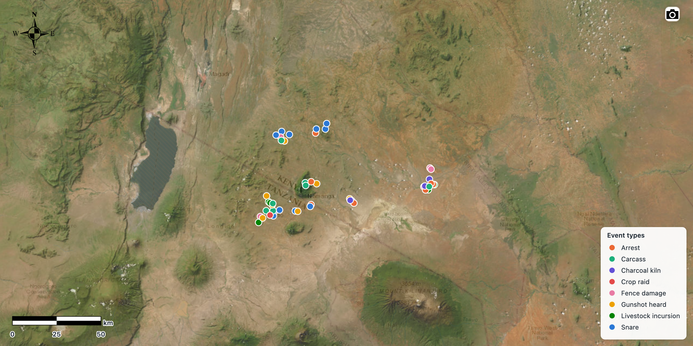

# Incident Map Plot

An EarthRanger workflow that downloads **incidents** (ER's collections of related events) with **all of their events**, and shows the events on a **map**: each one drawn with its EarthRanger event icon, or as a dot in its event-type colour, with a legend of event types.

It is one output of the incident report, split out on its own so it can be combined with other outputs elsewhere.



## Output

| Output | Shows |
|---|---|
| Map of incident events (widget) | Each located event as its ER icon or a coloured dot. The legend lists the event types, with their icons or colours; with one incident, its title is the incident. Events of one incident at the same spot (~10 m) share a count badge. Hover shows the event, type, time, state and incident. Events without a location aren't drawn. |

Every event type has one colour, the same in every view: the most common type takes the first of 16 set colours (`color_map_by_frequency`, then `apply_color_map`). incident-storyboard and incident-sunburst-plot use the same list and order, so their colours agree.

## Parameters

| Parameter | Notes |
|---|---|
| Data Source | EarthRanger connection |
| Time Range | Selects incidents by their own date. **All** of an incident's events are included, even those dated outside the range. Times are shown in the range's timezone. |
| Group by | Optional. **Incident** gives one map per incident. |
| Base Maps | The tile layers under the map; the first is the bottom layer. |
| Show event icons on the map | On (default): ER event icons. Off: dots in the event-type colour. |

## How it works

```
get_incident_events (platform)   incidents in the range → their events, display names, icons
  → convert_values_to_timezone
  → color_map_by_frequency (event_type_display → {type: colour}, most common first)
  → apply_color_map (→ type_color)
  → split_groups (Incident, or all)
  → draw_incident_events_map (ext-wd) → persist_text → map widget
  → gather_dashboard
```

Tasks come from `ecoscope-platform` (≥ 2.37.0) and, for the map, `ecoscope-workflows-ext-wd` 0.0.20 ([wd-partner-tasks](https://github.com/wildlife-dynamics/wd-partner_tasks), `src/ecoscope-workflows-ext-wd`). Both packages have a task named `get_incident_events`; the spec names the platform one by its module path. Nested incidents are followed up to 5 levels deep and icons are always downloaded (`max_depth: 5`, `include_icons: true`, fixed in `spec.yaml`).

## Local development

```bash
make compile          # compile spec.yaml and install the workflow env
make run-mock         # run on mock-io/ data and preview the dashboard
make run              # run on real data (param.yaml)
make test CASE=wd-by-incident
```

Mock data: `mock-io/get-incident-events.example-return.parquet` (Wildlife Dynamics site, 4 incidents, 8 events, 6 with a location), used through `WT_TASK_MOCK_IO__ECOSCOPE_PLATFORM_TASKS_IO_GET_INCIDENT_EVENTS` in the Makefile. `wd-all-incidents` draws dots, `wd-by-incident` draws icons.

## Release

Bump `ecoscope-workflows-incident-map-plot-workflow/VERSION.yaml` in a PR to `main`; CI checks the compiled files are up to date, runs every test case (`dev/run-test-cases.sh --all`) and, on merge, tags `vX.Y.Z` and creates the GitHub release. Compile with `make compile`, which builds the `gcp` variant the web app runs.
