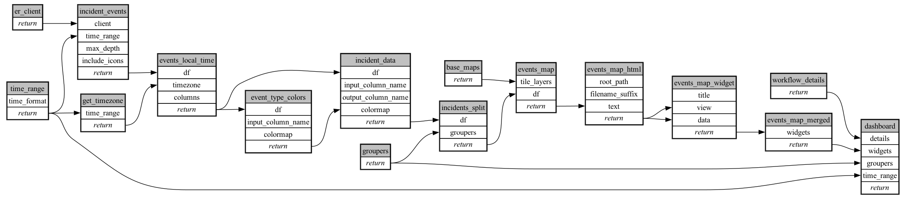

```
# AUTOGENERATED BY ECOSCOPE-WORKFLOWS; see fingerprint in README.md for details

```

```yaml
# fingerprint:
artifacts_sha256_basic: caff2f17f392a16efba441dd76808dc8463964f4d7691b341fcbcfdc6f0214cf
artifacts_sha256_strict: 87849d2a151e6a8994446ad42d3efd7b44d8a7d56afdbf98a39a0643a9728865
installed_requirements:
- channel: https://repo.prefix.dev/ecoscope-workflows/
  name: ecoscope-platform
  version: {version: ==2.37.0}
- channel: https://repo.prefix.dev/ecoscope-workflows-custom/
  name: ecoscope-workflows-ext-wd
  version: {version: ==0.0.20}
- channel: conda-forge
  name: pydeck
  version: {version: ==0.9.2}
params_sha256: 8967581ee14c09a2f31b6e95437250c69c839cf3a414059ea5ab67afc8ac9dc3
spec_sha256: 9140aea10db9aaab438d827c3e369fc4535d0bae3734f07a61677a86b650b109

```

# ecoscope-workflows-incident-map-plot-workflow


